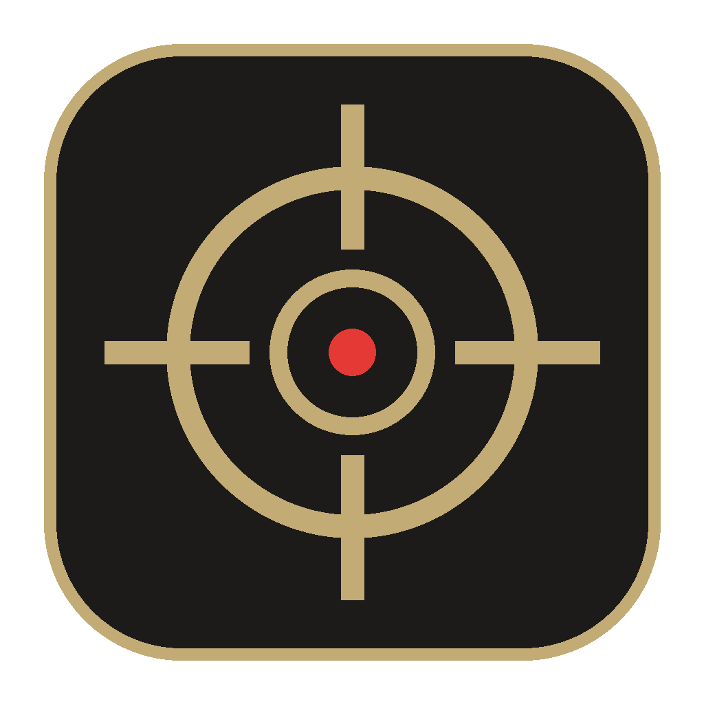

<p align="center">
  
</p>

<h1 align="center">Tarkov Helper</h1>

<p align="center">
  <b>Лаборатория без гугления.</b> Где лежит LEDX, за какой картой GPU и сколько всё это стоит прямо сейчас — на одной карте.
</p>

<p align="center">
  <a href="https://github.com/bobisdacool1/TarkovHelper/releases/latest"><b>⬇ Скачать для macOS и Windows</b></a>
</p>

---

## Зачем

Перед заходом на Лабу обычно открыто пять вкладок: интерактивная карта, вики по картам доступа, барахолка, список «что сейчас дорого»… Tarkov Helper собирает это в одно окно и отвечает на главный вопрос рейда: **куда бежать за деньгами и что для этого взять с собой**.

## Что умеет

- **Весь ценный лут Лабы на карте.** Каждая точка спавна из данных tarkov.dev с текущей ценой. Цвет маркера — сразу понятно, где миллион, а где мелочь.
- **Три этажа на одном экране** — подвал, первый и второй рядом, без переключателей. Или один этаж на весь экран, если так удобнее.
- **Фильтр «Дороже N»** — 50k, 100k, 200k, 500k, 1M или весь лут, если нужна конкретная мелочь.
- **Доступ: что за какой дверью.** Комнаты красной, синей, чёрной, фиолетовой карт и ключей обведены на карте. В меню видно, сколько лута и на какую сумму лежит за каждой картой, и сколько стоит сама карта — можно оставить «только синюю» и понять, окупится ли заход.
- **Поиск как у людей.** `ledx`, `черная`, `gpu`, несколько слов сразу и `-плакат`, чтобы исключить. Русские и английские названия, ё = е.
- **Категории с подкатегориями.** Ключ-карты, электроника, ценности, стимуляторы, медицина, топливо… Раскрывай и отмечай нужное поштучно.
- **Цены PvP и PvE.** Берётся лучшее из барахолки и скупки у торговцев, рядом подписано, кому продавать.
- **Двери и выходы** — плашки с цветом нужной карты, выходы ЧВК, общие и переходы.
- **Всё обновляется само.** Цены подтягиваются при запуске и каждые 30 минут, приложение обновляется одной кнопкой, разметка зон приходит из репозитория без переустановки.
- **Помнит настройки** — режим, фильтры, скрытые предметы и этаж остаются между запусками.
- **Рейды и средний профит по картам.** После рейда открываешь оверлей с вынесенным рюкзаком, убираешь лишнее, выбираешь карту — и видишь, где фармить выгоднее всего. *(Распознавание рюкзака — вместе со сканером.)*
- **Сканер цен** *(в разработке, Windows)*. Горячая клавиша с любыми модификаторами, режим «пока держу клавишу», живое превью оверлея: цена за клетку, барахолка, лучший торговец и нужен ли предмет для убежища и задач.
- **Blazing fast.** Rust + [GPUI](https://gpui.rs) (движок редактора Zed), рисует на видеокарте, без Electron и браузера.
  Наш замер на Mac с Apple M3 (release-сборка): данные из кэша грузятся за **~0,3 с**, в простое **~0,6% CPU**, около **300 МБ** памяти вместе с текстурами трёх этажей, само приложение весит **15 МБ**.

## Установка

Скачай последнюю версию на странице [Releases](https://github.com/bobisdacool1/TarkovHelper/releases/latest):

| Система | Файл |
|---|---|
| macOS, Apple Silicon (M1–M4) | `TarkovHelper_*_macos-aarch64.dmg` |
| macOS, Intel | `TarkovHelper_*_macos-x86_64.dmg` |
| Windows 10/11 | `TarkovHelper_*_windows-x86_64-setup.exe` |

> **macOS:** сборка пока не подписана сертификатом Apple, поэтому при первом запуске система предупредит о неизвестном разработчике. Открой через правый клик → «Открыть», либо выполни в терминале:
> `xattr -dr com.apple.quarantine "/Applications/Tarkov Helper.app"`
>
> **Windows:** SmartScreen может показать «Windows защитила ваш компьютер» → «Подробнее» → «Выполнить в любом случае».

Дальше обновления ставятся из самого приложения: когда выйдет новая версия, в меню появится кнопка «Обновить».

## Откуда данные

- Цены, предметы, точки лута, двери и выходы — открытые дампы [tarkov.dev](https://tarkov.dev) (`json.tarkov.dev`).
- Подложка карты — тайлы tarkov.dev.
- Зоны комнат за дверями размечены вручную и лежат в [`assets/labs_rooms.json`](assets/labs_rooms.json).

Цена = максимум из `lastLowPrice` на барахолке и лучшей цены у торговца. У ключ-карт с несколькими использованиями барахолка не различает износ, так что цена ориентировочная.

## Для разработчиков

```bash
cargo run
```

Нужен Rust stable. Полный Xcode не обязателен: шейдеры GPUI собираются при запуске (`runtime_shaders`).

### Редактор зон

Зоны комнат рисуются в браузере полигональным лассо (клик — точка, Shift — ровная линия, углы до 12° выравниваются сами):

```bash
python3 tools/zone-editor/server.py
```

Открой http://localhost:8790 — «Сохранить» пишет прямо в `assets/labs_rooms.json`. В приложении нажми «перечитать зоны». После пуша в `main` релизные сборки подхватят новую разметку сами.

### Сборка установщиков локально

```bash
cargo install cargo-packager --locked
cargo build --release
cargo packager --release --formats app,dmg   # macOS
cargo packager --release --formats nsis      # Windows
```

### Выпуск версии

1. Подними `version` в `Cargo.toml`.
2. Закоммить и поставь тег: `git tag v0.2.0 && git push --tags`.
3. GitHub Actions соберёт macOS (arm64, x86_64) и Windows, подпишет пакеты обновления и выложит релиз с `latest.json` — у пользователей появится кнопка «Обновить».

Для подписи обновлений в настройках репозитория должны быть секреты `CARGO_PACKAGER_SIGN_PRIVATE_KEY` и `CARGO_PACKAGER_SIGN_PRIVATE_KEY_PASSWORD` (пара к публичному ключу [`assets/updater.pub`](assets/updater.pub)).

## Планы

Ближайшее:

- **Цена предмета прямо в рейде.** Горячая клавиша, и над предметом под курсором всплывает цена и где выгоднее продать. Только снимок экрана и распознавание иконки, без вмешательства в игру.
- **Стоимость вынесенного рюкзака.** Открыл инвентарь после рейда — видишь, сколько вынес, и что продать на барахолке, а что торговцам.
- **Прогресс по убежищу и задачам.** Отмечаешь, что уже построено и выполнено, а на карте и в списке подсвечиваются предметы, которые ещё нужны («верстак ×2»).
- **Билды оружия.** Сборки, совместимость модулей и цена сборки.

Дальше:

- Остальные карты: Таможня, Улицы, Резерв…
- Контейнеры (ящики с инструментами, сейфы, ПК) отдельным слоем.
- Лестницы и переходы между этажами.
- Сезонный режим и альтернативные источники цен.

---

<sub>Неофициальный фанатский проект, не связан с Battlestate Games. Escape from Tarkov — торговая марка Battlestate Games. Поле ввода основано на примере из GPUI (Apache-2.0).</sub>
